---

title: '倾向得分匹配（PSM）'
published: 2025-09-10
image: './p25_cover.jpg'
description: '计量经济学中的常用方法'
category: 'Statistics'
tags: [MatchIt,R,ZH-CN]
draft: false
lang: 'en'
---
>
> - Cover Pic by [@BISQQQUE](https://www.pixiv.net/artworks/134520959)

## 参考
> [傾向スコア解析(1)：ロジスティック回帰モデルで傾向スコア（propensity score）を推定する [R]](https://necostat.hatenablog.jp/entry/2022/04/04/190303)  
> [傾向スコア解析(2)：傾向スコアを使った逆確率重み付け法（IPW）で交絡を調整する [R]](https://necostat.hatenablog.jp/entry/2022/04/05/065854)  
> [傾向スコア解析(3)：傾向スコアマッチング（PSM）を使って交絡を調整する [R]](https://necostat.hatenablog.jp/entry/2022/04/06/001353)

*(IDE中途从vscode换成了positron了，输出没有了html格式)*
## 使用倾向得分调整混淆变量的方法
- 匹配
- 分层
- 以倾向得分为变量的回归模型
- 逆概率加权法

## 示例数据
- 加载R包和数据
```r
library(tidyverse) # Basic tidy R style
library(tableone) # Group comparision
library(PSAgraphics) # Dataset
library(MatchIt) # PSM

data("lindner")
```

- 变量调整：增加`death`，表示是否死亡
```r
dt <- lindner %>% 
	mutate(death = if_else(lifepres==0,1,0))
head(dt)
```

<table class="dataframe">
<caption>A data.frame: 6 x 11</caption>
<thead>
	<tr><th></th><th scope=col>lifepres</th><th scope=col>cardbill</th><th scope=col>abcix</th><th scope=col>stent</th><th scope=col>height</th><th scope=col>female</th><th scope=col>diabetic</th><th scope=col>acutemi</th><th scope=col>ejecfrac</th><th scope=col>ves1proc</th><th scope=col>death</th></tr>
	<tr><th></th><th scope=col>&lt;dbl&gt;</th><th scope=col>&lt;int&gt;</th><th scope=col>&lt;int&gt;</th><th scope=col>&lt;int&gt;</th><th scope=col>&lt;int&gt;</th><th scope=col>&lt;int&gt;</th><th scope=col>&lt;int&gt;</th><th scope=col>&lt;int&gt;</th><th scope=col>&lt;int&gt;</th><th scope=col>&lt;int&gt;</th><th scope=col>&lt;dbl&gt;</th></tr>
</thead>
<tbody>
	<tr><th scope=row>1</th><td> 0.0</td><td>14301</td><td>1</td><td>0</td><td>163</td><td>1</td><td>1</td><td>0</td><td>56</td><td>1</td><td>1</td></tr>
	<tr><th scope=row>2</th><td>11.6</td><td> 3563</td><td>1</td><td>0</td><td>168</td><td>0</td><td>0</td><td>0</td><td>56</td><td>1</td><td>0</td></tr>
	<tr><th scope=row>3</th><td>11.6</td><td> 4694</td><td>1</td><td>0</td><td>188</td><td>0</td><td>0</td><td>0</td><td>50</td><td>1</td><td>0</td></tr>
	<tr><th scope=row>4</th><td>11.6</td><td> 7366</td><td>1</td><td>0</td><td>175</td><td>0</td><td>1</td><td>0</td><td>50</td><td>1</td><td>0</td></tr>
	<tr><th scope=row>5</th><td>11.6</td><td> 8247</td><td>1</td><td>0</td><td>168</td><td>1</td><td>0</td><td>0</td><td>55</td><td>1</td><td>0</td></tr>
	<tr><th scope=row>6</th><td>11.6</td><td> 8319</td><td>1</td><td>0</td><td>178</td><td>0</td><td>0</td><td>0</td><td>50</td><td>1</td><td>0</td></tr>
</tbody>
</table>

- `death`：经皮冠状动脉介入治疗（PCI）后6个月的预后（0=生存, 1=死亡）
- `abcix`：有无使用abciximab（0=PCI, 1=PCI+abciximab）
- `stent`：有无留置冠动脉支架（0=无, 1=有）
- `height`：身長（cm）
- `female`：性別（0=男性, 1=女性）
- `diabetic`：有无糖尿病（0=无, 1=有）
- `acutemi`：7天以内有无急性心肌梗塞（0=无, 1=有）
- `ejecfrac`：左心室收缩率（%）
- `ves1proc`：病变血管数量

- 查看组间的差异
```r
table_crude <- CreateTableOne(
	vars = c(
		"stent", "height", "female", 
        "diabetic", "acutemi", "ejecfrac", 
        "ves1proc","death"
	),
	   factorVars = c(
		   "stent", "female", "diabetic", 
		   "acutemi","death"
	   ),
	   strata = "abcix",
	   data = dt,
	   test = FALSE,
	   smd = TRUE)
print(table_crude, smd = TRUE)
```

```js
Stratified by abcix
                       0              1              SMD   
  n                       298            698               
  stent = 1 (%)           174 (58.4)     492 (70.5)   0.255
  height (mean (SD))   171.45 (10.59) 171.44 (10.69) <0.001
  female = 1 (%)          115 (38.6)     231 (33.1)   0.115
  diabetic = 1 (%)         80 (26.8)     143 (20.5)   0.150
  acutemi = 1 (%)          18 ( 6.0)     125 (17.9)   0.372
  ejecfrac (mean (SD))  52.29 (10.30)  50.40 (10.42)  0.182
  ves1proc (mean (SD))   1.20 (0.48)    1.46 (0.71)   0.427
  death = 1 (%)            15 ( 5.0)      11 ( 1.6)   0.194
```

##  使用逻辑回归估计倾向得分
### 逻辑回归估计
- 过程很简单，就是先建立逻辑回归模型，  
  再用模型重新预测元数据集得到样本的预测结果及预测概率
```r
ps_model <- glm(
	abcix ~ stent + height + female + 
		diabetic + acutemi + ejecfrac + ves1proc, 
	data = dt, 
	family = binomial(link="logit")
)

dt <- dt %>%
	mutate(
		ps_logit = predict(ps_model, type = "link"),
		ps = predict(ps_model, type = "response")
)

head(dt)
```

<table class="dataframe">
<caption>A data.frame: 6 x 13</caption>
<thead>
	<tr><th></th><th scope=col>lifepres</th><th scope=col>cardbill</th><th scope=col>abcix</th><th scope=col>stent</th><th scope=col>height</th><th scope=col>female</th><th scope=col>diabetic</th><th scope=col>acutemi</th><th scope=col>ejecfrac</th><th scope=col>ves1proc</th><th scope=col>death</th><th scope=col>ps_logit</th><th scope=col>ps</th></tr>
	<tr><th></th><th scope=col>&lt;dbl&gt;</th><th scope=col>&lt;int&gt;</th><th scope=col>&lt;int&gt;</th><th scope=col>&lt;int&gt;</th><th scope=col>&lt;int&gt;</th><th scope=col>&lt;int&gt;</th><th scope=col>&lt;int&gt;</th><th scope=col>&lt;int&gt;</th><th scope=col>&lt;int&gt;</th><th scope=col>&lt;int&gt;</th><th scope=col>&lt;dbl&gt;</th><th scope=col>&lt;dbl&gt;</th><th scope=col>&lt;dbl&gt;</th></tr>
</thead>
<tbody>
	<tr><th scope=row>1</th><td> 0.0</td><td>14301</td><td>1</td><td>0</td><td>163</td><td>1</td><td>1</td><td>0</td><td>56</td><td>1</td><td>1</td><td>-0.37258319</td><td>0.4079170</td></tr>
	<tr><th scope=row>2</th><td>11.6</td><td> 3563</td><td>1</td><td>0</td><td>168</td><td>0</td><td>0</td><td>0</td><td>56</td><td>1</td><td>0</td><td> 0.31645572</td><td>0.5784602</td></tr>
	<tr><th scope=row>3</th><td>11.6</td><td> 4694</td><td>1</td><td>0</td><td>188</td><td>0</td><td>0</td><td>0</td><td>50</td><td>1</td><td>0</td><td> 0.09786545</td><td>0.5244469</td></tr>
	<tr><th scope=row>4</th><td>11.6</td><td> 7366</td><td>1</td><td>0</td><td>175</td><td>0</td><td>1</td><td>0</td><td>50</td><td>1</td><td>0</td><td>-0.10918387</td><td>0.4727311</td></tr>
	<tr><th scope=row>5</th><td>11.6</td><td> 8247</td><td>1</td><td>0</td><td>168</td><td>1</td><td>0</td><td>0</td><td>55</td><td>1</td><td>0</td><td>-0.02781550</td><td>0.4930466</td></tr>
	<tr><th scope=row>6</th><td>11.6</td><td> 8319</td><td>1</td><td>0</td><td>178</td><td>0</td><td>0</td><td>0</td><td>50</td><td>1</td><td>0</td><td> 0.25152728</td><td>0.5625524</td></tr>
</tbody>
</table>

- `ps`为倾向得分
- `ps_logit`为倾向得分的logit变换值

- 通过对两组的可视化也可以看出，接受治疗的组的倾向得分更高
```r
ggplot(aes(x = ps, fill = factor(abcix)), data=dt) +
	geom_density(alpha=.25) +
	theme_bw()
```

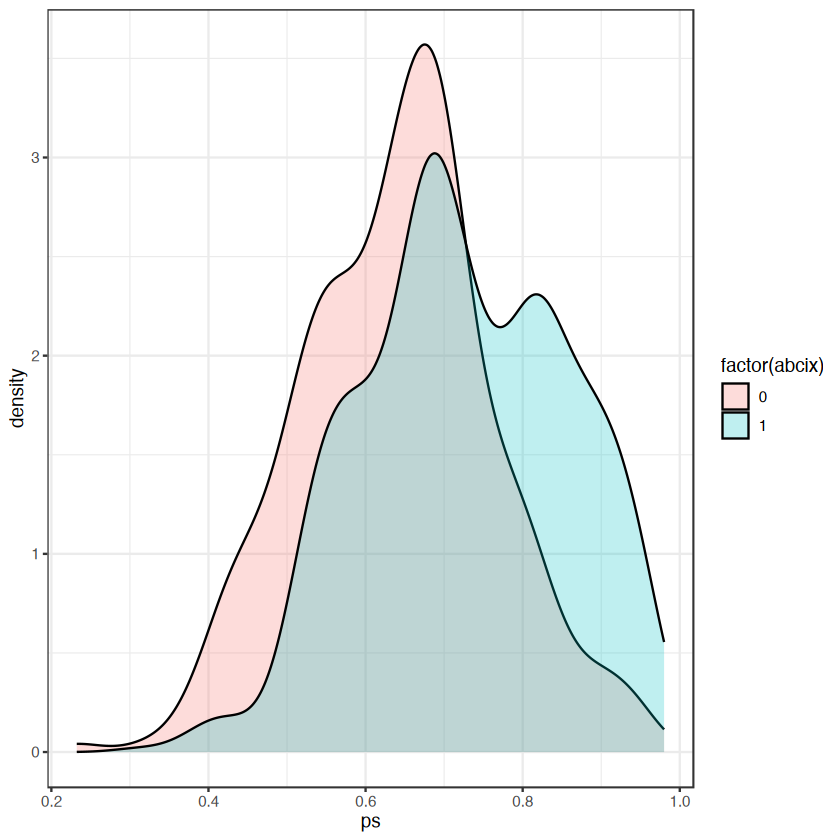

### ROC曲线
- 做ROC曲线看拟合程度
```r
library(pROC)
roc_ps <- roc(abcix ~ ps_logit, data = dt, ci = TRUE)
ggroc(
	roc_ps,
	size = 1,
	legacy.axes = TRUE
) +
	geom_abline(color="dark grey", size=0.5) +
	theme_bw()
```

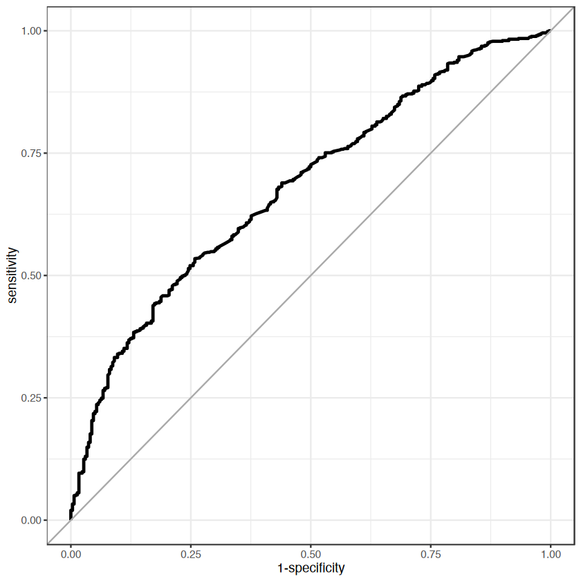

- 查看ROC-AUC
```r
roc_ps
```

```js
Call:
roc.formula(formula = abcix ~ ps_logit, data = dt, ci = TRUE)

Data: ps_logit in 298 controls (abcix 0) < 698 cases (abcix 1).
Area under the curve: 0.6807
95% CI: 0.6457-0.7156 (DeLong)
```

- AUC
	- AUC过低表明预测能力不足
	- AUC过高则显示其中一组更容易预测，  
	  会导致再另一组中难以匹配到对应个体
	- 0.6–0.8的范围内比较合适

### Hosmer-Lemeshow检验
- 检验模型拟合程度的方法
- $H_0$：预测值与观测值是一致的
```r
library(ResourceSelection)
hoslem.test(
	dt$abcix,
	fitted(ps_model),
	g=10
)
```

```js

	Hosmer and Lemeshow goodness of fit (GOF) test

data:  dt$abcix, fitted(ps_model)
X-squared = 8.7059, df = 8, p-value = 0.3677
```

- 本事例中 p = 0.3677 > 0.05，  
  可以认为模型拟合得没有问题

## 使用倾向得分的逆概率加权法（IPW）
### 权重的计算

- Average Treatment Effect (ATE)  
  $$w_i = \frac{Z_i}{p_{1i}} + \frac{1-Z_i}{1-p_{1i}}$$
- Average Treatment Effect on the Treated (ATT)  
  $$w_i = Z_i + (1-Z_i)\frac{p_{1i}}{1-p_{1i}}$$

- 使用ATE计算权重
```r
dt <- dt %>%
  mutate(wt = if_else(abcix==1,1/ps,1/(1-ps)))
```

### 极端权重值的对应方法
- 方法
	- 重新考虑是否使用倾向得分模型
	- 使用倾向得分进行其他的分析
	- 权重截断（weight truncation）
	- 稳定权重（stabilized weight）

- 权重截断
	- 这里将0.99以上的权重值改为0.99
```r
dt <- dt %>%
	mutate(
		wt_trun = if_else(
			wt > quantile(wt, prob = 0.99),
			quantile(wt, prob = 0.99),
			wt
		)
	)
```

- 稳定权重
	- 在ATE的基础上分别乘以概率的均值  
	  $$w_i = c_1 \frac{Z_i}{p_{1i}} + c_0 \frac{1-Z_i}{1-p_{1i}}$$
```r
dt <- dt %>%
  mutate(c1 = mean(ps), 
         c0 = mean(1-ps),
         wt_stab = if_else(abcix==1,wt*c1,wt*c0))
```

### 对3种加权方式的比较
```r
res <- dt %>% 
	pivot_longer(
		cols=c(wt,wt_trun,wt_stab),
		names_to = "wt_type", 
		values_to = "weight") %>%
	group_by(wt_type) %>%
	do(
		plots = 
			ggplot(data=., aes(x=weight)) +
				geom_density(aes(colour=factor(abcix))) +
				scale_x_continuous(limits = c(0,10)) + 
				ggtitle(.$wt_type) + 
				theme_bw()
	)
res[[2]]
```

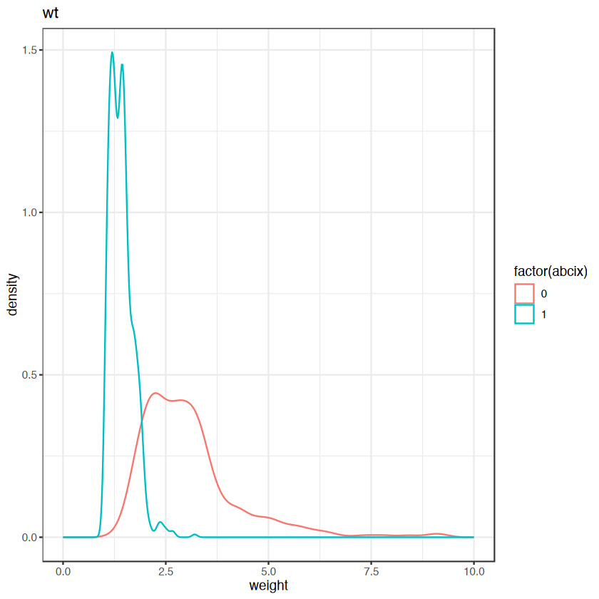
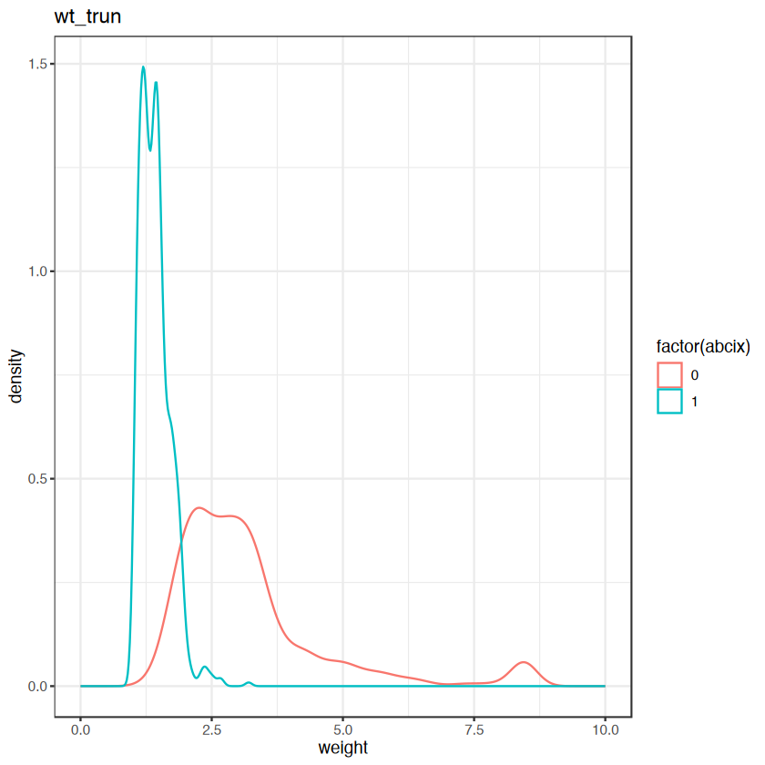
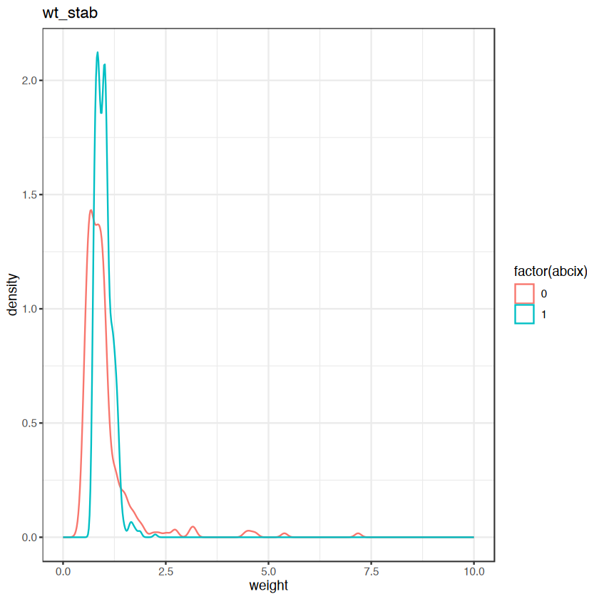

### `WeightIt`包的一步到位
- `weightit()`
```r
library(WeightIt)
wt_out <- weightit(
	abcix ~ stent + height + female + diabetic + acutemi + ejecfrac + ves1proc,
	data = dt, 
	estimand = "ATE", 
	method = "ps",
	stabilize = FALSE
)
```

- 结果出存在`wt_out$weights`中

- `summary()`可以查看汇总信息
	- 权重范围
	- 按分组给出5个极端权重值
	- 权重统计值
		- `Coef of Var`：变异系数，  
		  衡量权重的相对离散程度；  
		  值越大，说明权重差异越大
		- `MAD`：平均绝对离差，  
		  衡量权重偏离其均值的平均距离
		- `Entropy`：熵，  
		  衡量权重分布的均匀性；  
		  熵值越小，说明权重分布越不均匀
	- 有效样本量（ESS）
		- $$ESS = \frac{(\sum w_i)^2}{\sum w_i^2}$$
```r
summary(wt_out)
```

```js
Summary of weights

- Weight ranges:

           Min                                   Max
treated 1.0204 |-|                            3.2033
control 1.3027  |--------------------------| 23.9979

- Units with the 5 most extreme weights by group:
                                                
              34      80      93      72      22
 treated  2.4968  2.5399  2.6684   2.673  3.2033
             988     995     978     993     979
 control 14.8467 15.1977 15.6449 18.0062 23.9979

- Weight statistics:

        Coef of Var   MAD Entropy # Zeros
treated       0.200 0.154   0.019       0
control       0.703 0.368   0.153       0

- Effective Sample Sizes:

           Control Treated
Unweighted  298.    698.  
Weighted    199.68  671.09
```


### `cobalt`包检查权重平衡
- 由于上面的`summary()`结果只关注权重本身，  
  还需要使用 `cobalt` 包来检查加权后协变量是否真的达到了平衡
	- `"m"`：標準化平均差；  
	  对于连续变量，这是两组的均值之差；  
	  对于二元变量，这是两组的比例之差
	- `"V"`：分散比；  
	  计算处理组和控制组协变量的方差之比，只对连续变量有意义
	- `binary = "std"`: 这个参数指定了如何处理二元变量（Binary variables）；  
	  `"std"` 表示计算标准化的均值差异（ SMD）；  
	  这是目前最推荐和最常用的做法
```r
library(cobalt)
bal.tab(
	wt_out, 
	stats = c("m","v"), 
	binary = "std"
)
```

```js
Balance Measures
               Type Diff.Adj V.Ratio.Adj
prop.score Distance  -0.0192      0.9373
stent        Binary   0.0062           .
height      Contin.  -0.0120      0.8409
female       Binary   0.0217           .
diabetic     Binary  -0.0517           .
acutemi      Binary  -0.0032           .
ejecfrac    Contin.  -0.0005      0.9475
ves1proc    Contin.  -0.0736      0.9061

Effective sample sizes
           Control Treated
Unadjusted  298.    698.  
Adjusted    199.68  671.09
```

### `MatchIt`包检查权重平衡
- `MatchIt`包多用于PSM，  
  也可以通过设置`method = NULL`及`s.weights`来检查权重平衡
- `summary()`之后可以获得评估结果
	- `Means Treated`与`Means Control`：  
	  加权后，处理组和控制组中各个协变量的均值
	- `Std. Mean Diff.`：SMD
	- `Var. Ratio`：方差比
	- `eCDF Mean` \/ `eCDF Max`：  
	  经验累积分布函数（Empirical Cumulative Distribution Function）  
	  的均值差异和最大差异
		- 越接近0越好
	- **`Matched` / `Unmatched` / `Discarded`**:   
	  因为没有执行任何匹配操作，  
	  所以所有数据都被认为是匹配的，没有未匹配或丢弃的数据
```r
library(MatchIt)

wt_tab <- matchit(
	abcix ~ stent + height + female + diabetic + acutemi + ejecfrac + ves1proc,
        data = dt, 
        method = NULL, 
        s.weights = wt_out$weights
)

summary(wt_tab)
```

```js

Call:
matchit(formula = abcix ~ stent + height + female + diabetic + 
    acutemi + ejecfrac + ves1proc, data = dt, method = NULL, 
    s.weights = wt_out$weights)

Summary of Balance for All Data:
         Means Treated Means Control Std. Mean Diff. Var. Ratio eCDF Mean
distance        0.4981        0.4964          0.0865     0.9000    0.0187
stent           0.6702        0.6673          0.0063          .    0.0029
height        171.4044      171.5317         -0.0120     0.8409    0.0087
female          0.3438        0.3334          0.0219          .    0.0104
diabetic        0.2228        0.2447         -0.0526          .    0.0219
acutemi         0.1433        0.1443         -0.0029          .    0.0010
ejecfrac       50.9431       50.9481         -0.0005     0.9475    0.0133
ves1proc        1.3840        1.4284         -0.0670     0.9061    0.0078
         eCDF Max
distance   0.0492
stent      0.0029
height     0.0376
female     0.0104
diabetic   0.0219
acutemi    0.0010
ejecfrac   0.0422
ves1proc   0.0280

Sample Sizes:
              Control Treated
All (ESS)      199.68  671.09
All            298.    698.  
Matched (ESS)  199.68  671.09
Matched        298.    698.  
Unmatched        0.      0.  
Discarded        0.      0.  
```

### 估计治疗效果
- 使用`survey`包中的`svyglm()`函数来执行带权重的稳健标准误差估计广义线性回归
```r
library(survey)

dsgn_wt <- svydesign(~1, weights = wt_out$weights, data = dt)

fit <- svyglm(
	death ~ abcix, 
	design = dsgn_wt,
	# 使用quasibinomial避免关于非整数成功次数的警告
	family = quasibinomial(link = "logit")
)
              
summary(fit)              
```

```js
Call:
svyglm(formula = death ~ abcix, design = dsgn_wt, family = quasibinomial(link = "logit"))

Survey design:
svydesign(~1, weights = wt_out$weights, data = dt)

Coefficients:
            Estimate Std. Error t value Pr(>|t|)    
(Intercept)  -2.4250     0.3918  -6.190  8.8e-10 ***
abcix        -1.7471     0.5031  -3.472 0.000538 ***
---
Signif. codes:  0 '***' 0.001 '**' 0.01 '*' 0.05 '.' 0.1 ' ' 1

(Dispersion parameter for quasibinomial family taken to be 1.001005)

Number of Fisher Scoring iterations: 7
```

## `MatchIt`包进行倾向得分匹配
### 确定协变量的平衡性
- 内容和[之前](#`MatchIt`包检查权重平衡)的`MatchIt`包检查权重平衡相似
	- 只是没有指定`s.weights`参数 
```r
library(MatchIt)

unmatched <- matchit(
	abcix ~ stent + height + female + diabetic + acutemi + ejecfrac + ves1proc,
	data = dt, 
	method = NULL
)

summary(unmatched)
```

```js
Call:
matchit(formula = abcix ~ stent + height + female + diabetic + 
    acutemi + ejecfrac + ves1proc, data = dt, method = NULL)

Summary of Balance for All Data:
         Means Treated Means Control Std. Mean Diff. Var. Ratio eCDF Mean
distance        0.7265        0.6406          0.6609     1.1161    0.1714
stent           0.7049        0.5839          0.2652          .    0.1210
height        171.4427      171.4463         -0.0003     1.0201    0.0079
female          0.3309        0.3859         -0.1168          .    0.0550
diabetic        0.2049        0.2685         -0.1575          .    0.0636
acutemi         0.1791        0.0604          0.3095          .    0.1187
ejecfrac       50.4026       52.2886         -0.1810     1.0238    0.0356
ves1proc        1.4628        1.2047          0.3654     2.1614    0.0433
         eCDF Max
distance   0.2760
stent      0.1210
height     0.0250
female     0.0550
diabetic   0.0636
acutemi    0.1187
ejecfrac   0.1138
ves1proc   0.1884

Sample Sizes:
          Control Treated
All           298     698
Matched       298     698
Unmatched       0       0
Discarded       0       0
```

### 构建倾向得分匹配过的队列
- `matchit()`函数
	- `method`：匹配方法
		- `"nearest"`：最近邻匹配
	- `distance`：观测间得分距离
		- `"mahalanobis"`：马哈拉诺比斯距离 / 马氏距离
	- `estimand`：估计方法
		- `"ATT"`：对于那些接受了abcix治疗的患者，这个治疗到底有多大效果
	- `replace`：是否允许重复匹配
	- `ratio`：匹配比例，`1`为一对一匹配
	- `caliper`：  
	  匹配观测间距离的SD阈值；  
	  小于改阈值的观测将被匹配；  
	  例如设置为0.2的情况时，距离小于0.2个SD的观测被匹配
```r
matched_1 <- matchit(
	abcix ~ stent + height + female + diabetic + acutemi + ejecfrac + ves1proc,
	data = dt,
	method = "nearest",
	distance = "glm",
	link = "logit",
	estimand = "ATT",
	replace = FALSE,
	ratio = 1,
	seed = 42
)

summary(matched_1)
```

```js
Warning message:
"Fewer control units than treated units; not all treated units will get
a match."


Call:
matchit(formula = abcix ~ stent + height + female + diabetic + 
    acutemi + ejecfrac + ves1proc, data = dt, method = "nearest", 
    distance = "glm", link = "logit", estimand = "ATT", replace = FALSE, 
    ratio = 1, seed = 42)

Summary of Balance for All Data:
         Means Treated Means Control Std. Mean Diff. Var. Ratio eCDF Mean
distance        0.7265        0.6406          0.6609     1.1161    0.1714
stent           0.7049        0.5839          0.2652          .    0.1210
height        171.4427      171.4463         -0.0003     1.0201    0.0079
female          0.3309        0.3859         -0.1168          .    0.0550
diabetic        0.2049        0.2685         -0.1575          .    0.0636
acutemi         0.1791        0.0604          0.3095          .    0.1187
ejecfrac       50.4026       52.2886         -0.1810     1.0238    0.0356
ves1proc        1.4628        1.2047          0.3654     2.1614    0.0433
         eCDF Max
distance   0.2760
stent      0.1210
height     0.0250
female     0.0550
diabetic   0.0636
acutemi    0.1187
ejecfrac   0.1138
ves1proc   0.1884

Summary of Balance for Matched Data:
         Means Treated Means Control Std. Mean Diff. Var. Ratio eCDF Mean
distance        0.8517        0.6406          1.6242     0.2455    0.4407
stent           0.7852        0.5839          0.4414          .    0.2013
height        171.4295      171.4463         -0.0016     1.1500    0.0109
female          0.2919        0.3859         -0.1997          .    0.0940
diabetic        0.1644        0.2685         -0.2577          .    0.1040
acutemi         0.4128        0.0604          0.9190          .    0.3523
ejecfrac       47.7953       52.2886         -0.4313     1.2340    0.0800
ves1proc        1.9228        1.2047          1.0170     2.7619    0.1197
         eCDF Max Std. Pair Dist.
distance   0.8289          1.6242
stent      0.2013          0.9123
height     0.0403          1.0803
female     0.0940          0.8986
diabetic   0.1040          0.7400
acutemi    0.3523          1.0065
ejecfrac   0.2315          1.0980
ves1proc   0.5134          1.1405

Sample Sizes:
          Control Treated
All           298     698
Matched       298     298
Unmatched       0     400
Discarded       0       0
```

### 查看匹配后的协变量平衡性
- 在上面`summary()`后的结果中
	- **Summary of Balance for All Data：**  
	  匹配前的数据平衡性
    - **Summary of Balance for Matched Data：**  
      匹配后的数据平衡性
    - **Percent Balance Improvement：**  
      匹配前后数据平衡性的各指标改善百分比
    - **Sample Sizes：**  
      匹配的队列中选择的观测数

### 可视化匹配结果
- 散点图
```r
plot(matched_1, type = "jitter")
```

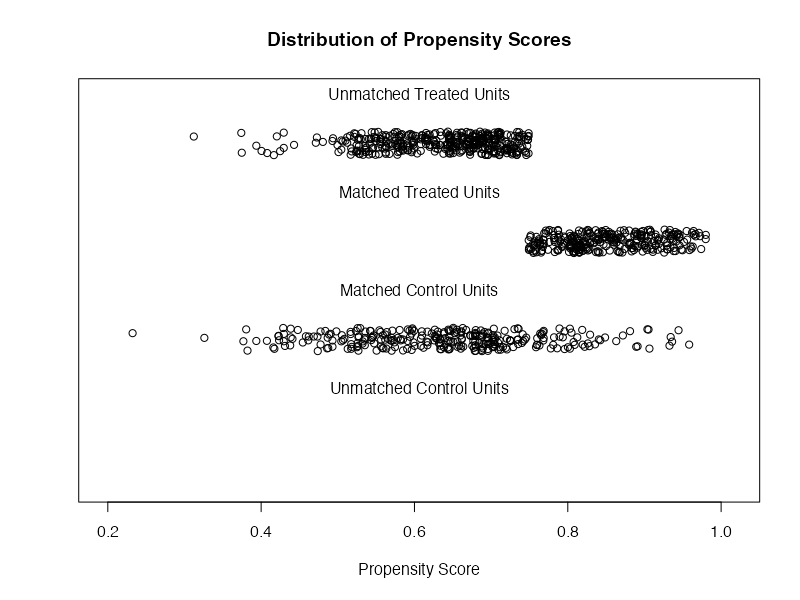

- 密度分布图
```r
plot(matched_1, type = "density")
```

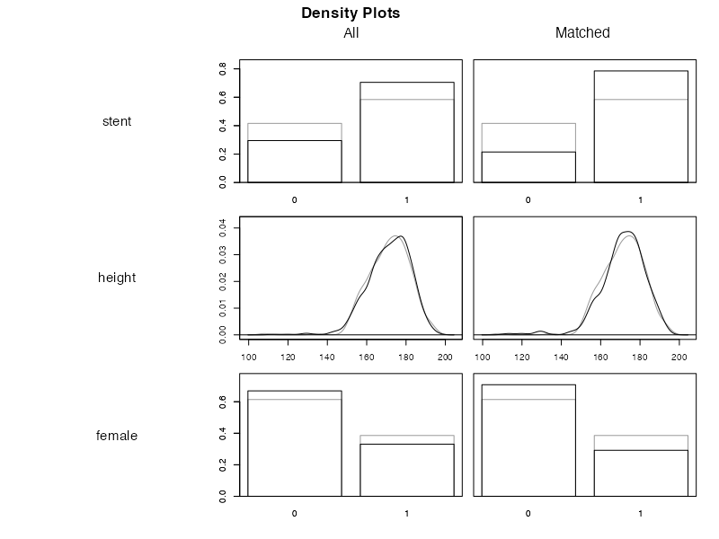
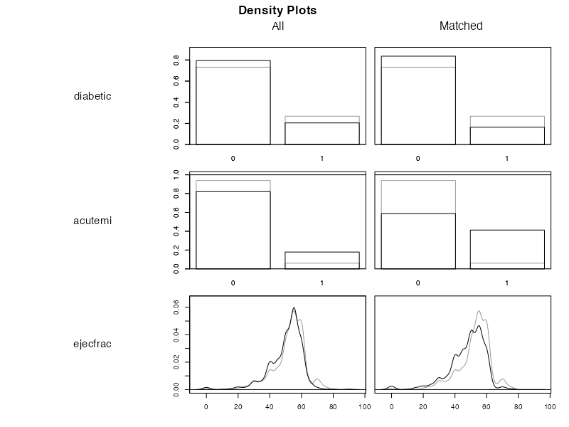
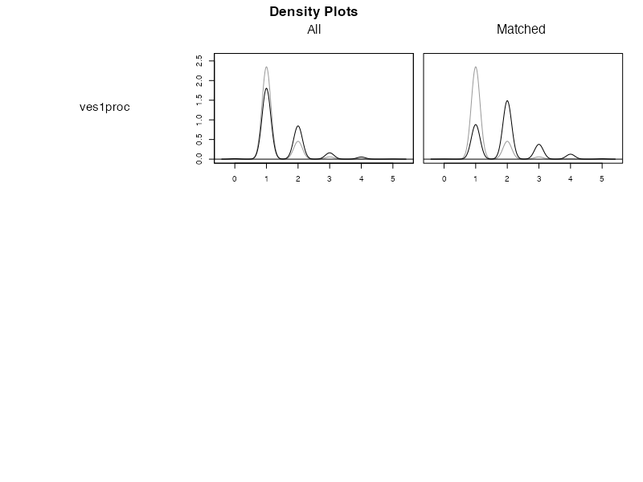

- QQ图（仅对连续变量）
```r
plot(
	matched_1, 
	type = "qq", 
	which.xs = c("height", "ejecfrac", "ves1proc")
)
```

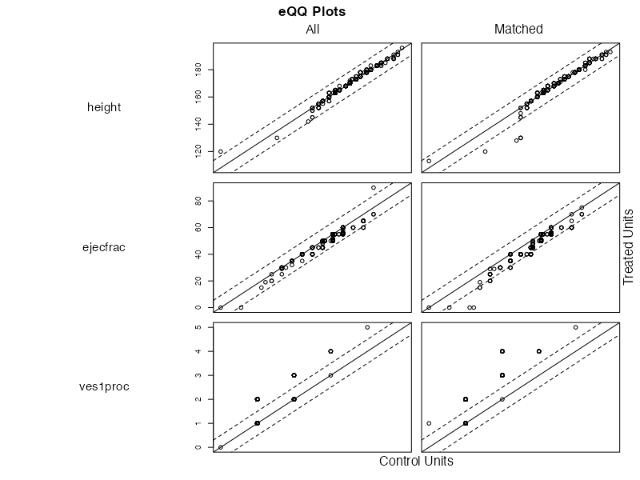

- eCDF图（仅对连续变量）
```r
plot(
	matched_1, 
	type = "ecdf", 
	which.xs = c("height", "ejecfrac", "ves1proc")
)
```

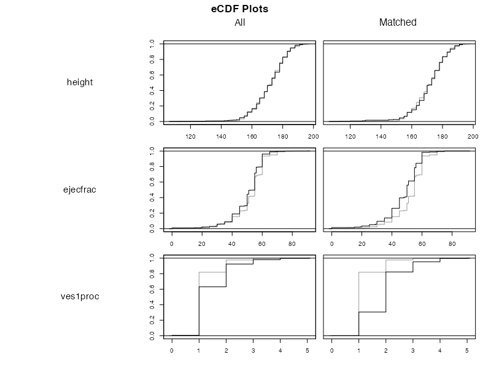

- 使用`cobalt`包可以对SMD进行可视化
```r
library(cobalt)
love.plot(matched_1, threshold = 0.15, abs = TRUE, stars = "raw")
```

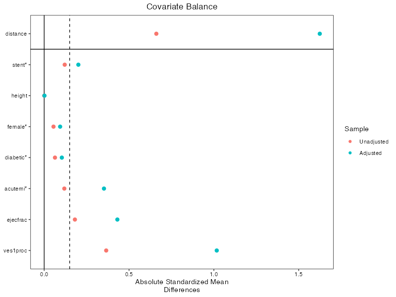

### 估计治疗效果
- `match.data()`能够将匹配后的各种参数合并到原数据集中
	- `distance`：与倾向得分`ps`相同，用于匹配
	- `weights`: 匹配权重（这里全为1，表示1:1匹配）
	- `subclass`：匹配后的配对编号
```r
m.out_1 <- match.data(matched_1)
head(m.out_1)
```

```js
lifepres cardbill abcix stent height female diabetic acutemi ejecfrac ves1proc death ps_logit        ps       wt
367      0.0    14990     1     1    157      1        1       0       45        2     1 1.215812 0.7713257 1.296469
369      0.0    96741     1     1    171      0        0       0       29        1     1 1.242675 0.7760293 1.288611
370     11.6     7616     1     1    168      1        0       0       51        2     0 1.364860 0.7965484 1.255416
371     11.6     7664     1     0    173      0        0       1       55        1     0 1.453961 0.8106073 1.233643
374     11.6     8321     1     0    180      0        0       1       60        1     0 1.272454 0.7811625 1.280143
375     11.6     8389     1     0    170      1        0       1       55        1     0 1.141000 0.7578631 1.319499
     wt_trun        c1        c0   wt_stab  distance weights subclass
367 1.296469 0.7008032 0.2991968 0.9085698 0.7713257       1        1
369 1.288611 0.7008032 0.2991968 0.9030628 0.7760293       1        2
370 1.255416 0.7008032 0.2991968 0.8797999 0.7965484       1        3
371 1.233643 0.7008032 0.2991968 0.8645409 0.8106073       1        4
374 1.280143 0.7008032 0.2991968 0.8971286 0.7811625       1        5
375 1.319499 0.7008032 0.2991968 0.9247094 0.7578631       1        6
```

- 使用上面`match.data()`过后的`m.out_1`直接进行`glm()`,  
  就能过获得估计后的治疗效果
```r
fit <- glm(death ~ abcix, data = m.out_1,
           family = binomial(link = "logit"),
           # 添加权重即可
           weights = weights)
summary(fit)
```

```js
Call:
glm(formula = death ~ abcix, family = binomial(link = "logit"), 
    data = m.out_1, weights = weights)

Coefficients:
            Estimate Std. Error z value Pr(>|z|)    
(Intercept)  -2.9374     0.2650 -11.086   <2e-16 ***
abcix        -0.7900     0.4653  -1.698   0.0895 .  
---
Signif. codes:  0 ‘***’ 0.001 ‘**’ 0.01 ‘*’ 0.05 ‘.’ 0.1 ‘ ’ 1

(Dispersion parameter for binomial family taken to be 1)

    Null deviance: 188.34  on 595  degrees of freedom
Residual deviance: 185.25  on 594  degrees of freedom
AIC: 189.25

Number of Fisher Scoring iterations: 6
```

- 为了进行更好的估计，推荐使用稳健方差估计来修正结果
```r
library(lmtest)
library(sandwich)

coeftest(fit, vcov. = vcovCL, cluster = ~subclass)
```

```js
z test of coefficients:

            Estimate Std. Error  z value Pr(>|z|)    
(Intercept) -2.93740    0.26540 -11.0679  < 2e-16 ***
abcix       -0.79002    0.45153  -1.7497  0.08018 .  
---
Signif. codes:  0 ‘***’ 0.001 ‘**’ 0.01 ‘*’ 0.05 ‘.’ 0.1 ‘ ’ 1
```

### 使用logit变换的倾向得分
- 如果使用倾向得分的logit变换值，  
  需要在`distance`指定
```r
# 先逻辑回归
ps_model <- glm(
	abcix ~ stent + height + female + diabetic + acutemi + ejecfrac + ves1proc, 
	data = dt, 
	family = binomial(link="logit")
)

# 获得预测的link与response值，
# link值就是logit变换值
dt <- dt %>%
	mutate(
		ps_logit = predict(ps_model, type = "link"),
		ps = predict(ps_model, type = "response")
	)

# 其他都一样，仅修改distance
matched_2 <- matchit(
	abcix ~ stent + height + female + diabetic + acutemi + ejecfrac + ves1proc,
	data = dt,
	method = "nearest",
	# 指定为ps_logit而不是glm
	distance = dt$ps_logit,
	caliper = 0.2,
	std.caliper = TRUE,
	ratio = 1,
	replace = F,
	seed = 42
	)

summary(matched_2)
```

```js
Call:
matchit(formula = abcix ~ stent + height + female + diabetic + 
    acutemi + ejecfrac + ves1proc, data = dt, method = "nearest", 
    distance = dt$ps_logit, replace = F, caliper = 0.2, std.caliper = TRUE, 
    ratio = 1, seed = 42)

Summary of Balance for All Data:
         Means Treated Means Control Std. Mean Diff. Var. Ratio eCDF Mean
distance        1.1148        0.6333          0.6048     1.6720    0.1714
stent           0.7049        0.5839          0.2652          .    0.1210
height        171.4427      171.4463         -0.0003     1.0201    0.0079
female          0.3309        0.3859         -0.1168          .    0.0550
diabetic        0.2049        0.2685         -0.1575          .    0.0636
acutemi         0.1791        0.0604          0.3095          .    0.1187
ejecfrac       50.4026       52.2886         -0.1810     1.0238    0.0356
ves1proc        1.4628        1.2047          0.3654     2.1614    0.0433
         eCDF Max
distance   0.2760
stent      0.1210
height     0.0250
female     0.0550
diabetic   0.0636
acutemi    0.1187
ejecfrac   0.1138
ves1proc   0.1884

Summary of Balance for Matched Data:
         Means Treated Means Control Std. Mean Diff. Var. Ratio eCDF Mean
distance        0.7978        0.6554          0.1788     1.0395    0.0616
stent           0.6438        0.5959          0.1051          .    0.0479
height        170.7671      171.5925         -0.0772     0.9794    0.0154
female          0.3562        0.3733         -0.0364          .    0.0171
diabetic        0.1918        0.2603         -0.1697          .    0.0685
acutemi         0.0719        0.0616          0.0268          .    0.0103
ejecfrac       51.5240       52.1301         -0.0582     0.9932    0.0222
ves1proc        1.2740        1.2123          0.0873     1.2880    0.0137
         eCDF Max Std. Pair Dist.
distance   0.1747          0.1798
stent      0.0479          0.6157
height     0.0616          1.0218
female     0.0171          0.7933
diabetic   0.0685          0.5940
acutemi    0.0103          0.2233
ejecfrac   0.0822          0.8556
ves1proc   0.0651          0.3589

Sample Sizes:
          Control Treated
All           298     698
Matched       292     292
Unmatched       6     406
Discarded       0       0
```
